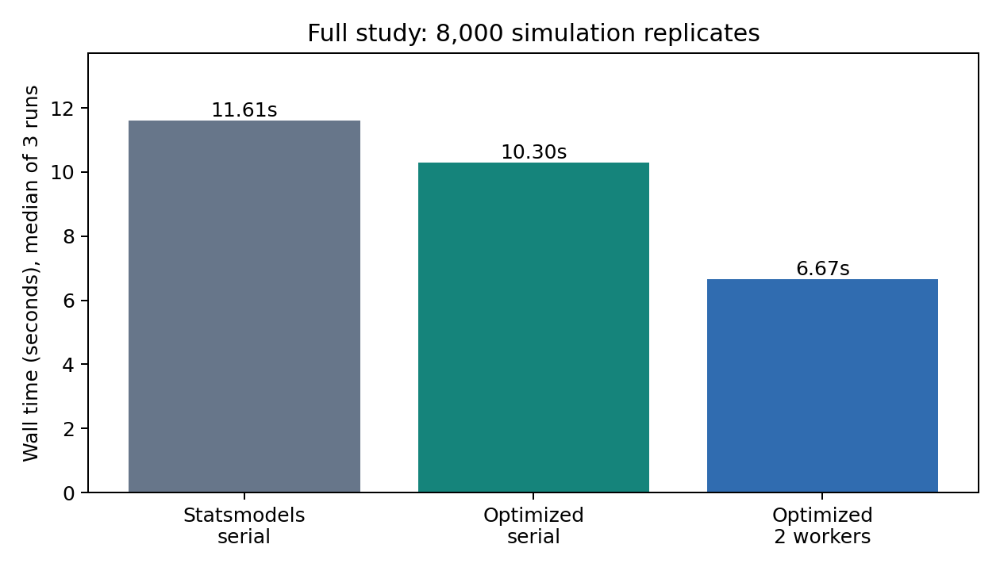
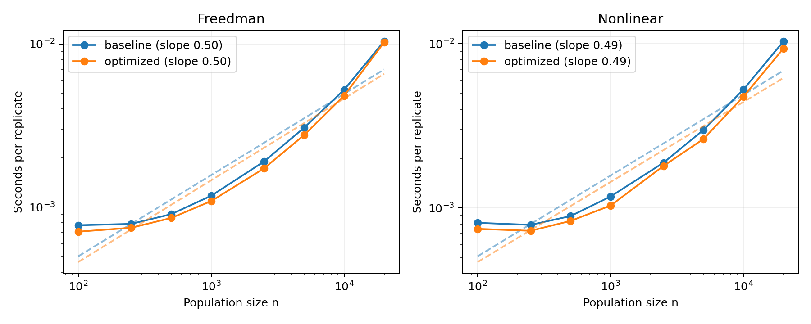

# Baseline performance

## Study and measurement protocol

The original Unit 2 simulation has two DGPs, n = 100, 500, 1,000, 5,000,
and 1,000 treatment randomizations per fixed population: 8,000 fits total.
The original source was preserved byte-for-byte in `baseline/` before edits.

The full original simulation took **14.749 seconds** in
this environment. Freedman: 7.435 s;
nonlinear: 7.309 s. This is a directly measured
run of the submitted driver, with only its output directory redirected. It
includes DGP generation, fitting, progress reporting, DataFrame creation and
CSV output; interpreter imports and subsequent metrics/plot generation are
excluded. This is the runtime of the entire simulation, not a scaled pilot.
The original run has 0 nonfinite values in each of its three estimator columns.

The original internally calls `np.random.seed(None)` and suppresses all fitting
warnings. Its top-level seed therefore does not reproduce its old output, and
absence of printed warnings is not evidence of convergence. The original
CSV results and timer are in `results/performance/original_baseline/` and
`baseline_full.json`. A separate instrumented audit below exposes failures.

For a fair performance comparison, both estimators also run through the same
explicitly seeded driver. Each timed run covers all 8,000 fits; three repetitions
alternate execution order. The table uses medians. Timers exclude CSV writing,
imports and warm-up, but include DataFrame construction and process overhead.
This explains why these times are not directly interchangeable with the
original-driver timer above.

| Implementation | Median (s) | Min-max (s) | Speedup vs baseline |
|---|---:|---:|---:|
| baseline, 1 worker(s) | 11.612 | 11.553-11.631 | 1.00x |
| optimized, 1 worker(s) | 10.300 | 10.296-10.875 | 1.13x |
| optimized, 2 worker(s) | 6.667 | 6.388-7.105 | 1.74x |

Environment: Python 3.12.14, NumPy 2.3.5,
SciPy 1.17.0, pandas 2.2.3, statsmodels 0.15.0.
Platform: Linux-6.18.57-x86_64-with-glibc2.41. The process sees 9 logical CPUs;
that does not guarantee exclusive access or equivalent physical cores.
BLAS/OpenMP/MKL thread limits are one. Timings are machine-specific and no
claims are made about universal parallel scaling. Raw values are in
`benchmark.csv`; software/platform details are in `environment.json`.

## Runtime profiling

`make profile` profiles 400 fits: 100 replicates for each DGP at n=1,000 and
n=5,000, using the seeded common driver and original estimator.
The cumulative-time profile identifies estimation as the bottleneck:

| Original component | Calls | Cumulative seconds |
|---|---:|---:|
| Full representative run | 1 | 1.125 |
| estimate_effects | 400 | 1.093 |
| Statsmodels Logit.fit (outer call) | 400 | 0.498 |
| add_constant | 1,200 | 0.329 |
| Logit initialization (outer call) | 400 | 0.174 |
| Treatment assignment | 400 | approximately 0.02 |

Cumulative rows overlap and must not be added. Approximately 97% of profiled
runtime is inside estimation. Constant detection/construction is surprisingly
expensive relative to fitting a model with only three coefficients. Full
30-row profiles and binary cProfile files are included. Optimized total
profiled time is 1.093 s, of which stable marginal-log-odds evaluation takes
0.353 s. Profiling affects timings; use the unprofiled benchmark for speedup.

## Complexity analysis

Let k be the number of Newton iterations and p=3 the fixed number of model
coefficients. DGP and treatment generation are O(n); fitting forms the
Hessian in O(n p^2) and solves a p-by-p system in O(p^3) per iteration.
The original fit therefore costs O(k(n p^2+p^3)), or O(kn) for fixed p.
Constant detection and counterfactual predictions add O(n). The optimized
fit has the same leading order; backtracking adds O(n) per attempted step.
No claim of a better asymptotic exponent is made. Near separation, k and the
number of backtracking attempts can increase; the solver uses an iteration cap.

For R replicates and scenario sizes n_j, total serial work is approximately
O(R sum_j k_j n_j). Working arrays cost O(n p+p^2), with O(R times number of
scenarios) stored output rows. Parallel workers multiply working memory.

`make complexity` times batches of 30 replicates for n=100 through 20,000,
five repetitions per DGP/n/engine. DGP setup and output-row assembly are
included; reported time is elapsed/30. At each n, medians are fitted by OLS
on natural log time against natural log n over the full range:

| DGP | Engine | Empirical log-log slope |
|---|---|---:|
| freedman | baseline | 0.498 |
| freedman | optimized | 0.501 |
| nonlinear | baseline | 0.492 |
| nonlinear | optimized | 0.487 |

Slopes near 0.5 in this finite range do not imply O(sqrt(n)) complexity.
An additive setup/interpreter cost plus an O(n) computation bends the log-log
curve, and iteration counts also vary. The theoretical fixed-k large-n
leading cost remains linear. The fitted slopes describe only the measured
range and are not extrapolation guarantees. Both algorithms have similar
slopes; the primary improvements affect constant factors and concurrency.

## Numerical warnings and convergence

The audit runs 100 replicates for each DGP at each n in
{20,100,500,1000,5000} (1,000 fits per engine), plus five deterministic
stress cases. The audit population seed is 908; assignment seeds are 0-99.
It enables the baseline's suppressed warnings, records swallowed exceptions,
and inspects the optimizer convergence flag without changing the arithmetic.

- At the original n values (800 audit fits per engine), neither engine has
  fitting warnings, convergence failures or nonfinite estimator values.
- Freedman at n=20: original has 11 nonconverged fits and 1 exception in 100
  replicates, with 11 warning events. Optimized flags 11 ill-conditioned fits
  and 1 singular-design fit. ITT is undefined for 12 replicates.
- Nonlinear at n=20: original has 11 nonconverged fits and 1 exception in 100,
  with 40 warning events. Optimized flags 10 ill-conditioned fits, 1
  nonconverged fit and 1 singular-design fit. ITT is undefined for 11 replicates.
- Constant-outcome stress: original returns finite coefficients despite
  nonconvergence (19 warnings); optimized explicitly reports constant outcome.
- Perfect-separation stress: original returns a finite unconverged fit
  (40 warnings); optimized reports nonconvergence and missing MLE/plug-in.
- Empty-arm and rank-deficient stresses cause original exceptions and explicit
  optimized singular-design statuses. Both engines finish the large-covariate
  stress without warnings; it is not claimed that baseline fails that case.

Optimized runs emit zero numerical warnings in this audit, but still report
failures. This is not evidence that all possible datasets are stable. The
nonexistent/ill-conditioned cases have not been silently converted to finite
estimates. See `stability_summary.csv`, `stability.csv` and
`stability_events.json` for denominators, per-replicate statuses and messages.
