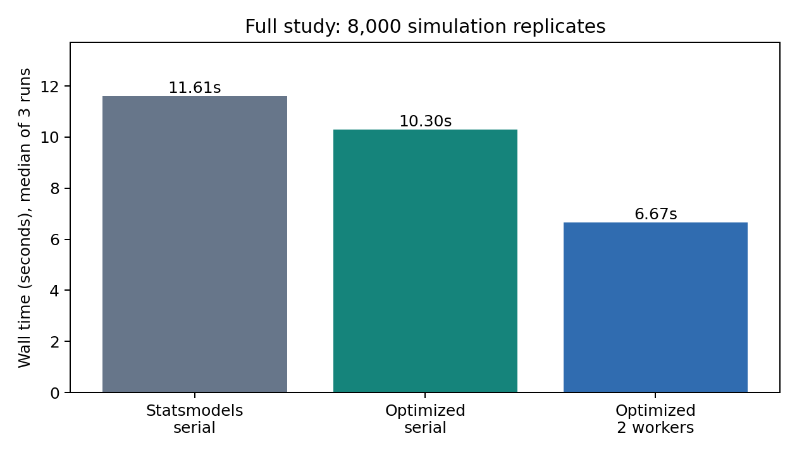

# Changes made to the simulation

The aim of this project is to make the Unit 2 simulation faster while keeping the statistical problem the same. The DGPs, treatment probability of 0.75, population sizes and number of replicates are unchanged. The population is still held fixed across the 1,000 treatment randomizations for each setting.

The main changes are in `src/optimized.py` and `src/runner.py`. The original code is kept for comparison.

## 1. Simplifying the logistic regression calculation

### Problem

The profiler showed that most of the time was spent in the estimation function. The original code uses statsmodels to fit a logistic regression in every replicate. For this simulation, only the treatment coefficient and fitted probabilities are needed, not standard errors or the other model output.

### Change

The new version calculates the Newton updates directly for the three regression coefficients. It fits the same unpenalized logistic model.

Before:

```python
exog = sm.add_constant(np.column_stack((X, Z)))
model = sm.Logit(Y_obs, exog).fit(disp=0, method='newton')
beta_hat_2 = model.params[1]
```

After, showing the main calculation:

```python
A = np.column_stack((np.ones(len(X)), X, z))
p = expit(A @ beta)
w = p * expit(-(A @ beta))
H = A.T @ (w[:, None] * A)
g = A.T @ (p - y)
step = np.linalg.solve(H, g)
beta = beta - scale * step
```

Here, `g` is the gradient and `H` is the Hessian of the negative log likelihood. The code solves a linear system to find the Newton step. If the full step increases the loss, it tries a smaller step. It stops only when both the parameter change and the gradient divided by n are small.

### Effect and limitation

This avoids creating a full statsmodels result object and calculating output that is not used. However, the new code is specific to this model and needs more checking than a standard library call. The convergence checks also take time. The combined serial changes reduce the median full-study runtime from 11.612 to 10.300 seconds. The effect of this change alone was not timed separately.

## 2. Avoiding repeated design matrices

### Problem

The original code creates two more design matrices in every replicate to predict outcomes with everyone treated and everyone untreated. It also repeatedly checks which columns are constant.

Before:

```python
exog_T = sm.add_constant(
    np.column_stack((np.ones_like(X), Z)), has_constant='add')
exog_C = sm.add_constant(
    np.column_stack((np.zeros_like(X), Z)), has_constant='add')
p_T = model.predict(exog_T)
p_C = model.predict(exog_C)
```

### Change

These linear predictors can be calculated directly using arrays:

```python
eta_c = beta[0] + beta[2] * z
eta_t = eta_c + beta[1]
```

The stable probability calculation described below then gives the plug-in estimate. Also, `w[:, None] * A` multiplies each row of the design matrix by its weight without creating a large diagonal matrix.

### Effect and limitation

This removes two n-by-3 arrays from the prediction step. With 64-bit numbers, those two arrays alone would use 240,000 bytes at n = 5,000. This is not a measurement of the total memory saved, since the new fitting code also uses temporary arrays.

The formulas are shorter and avoid repeated work, but they depend on the particular design matrix in this study. They would need to be changed if more covariates were added. Many parts of the original code already use NumPy arrays, so the change is mainly to remove unnecessary calculations.

## 3. Making the calculations more stable

### Problem

The original code suppresses fitting warnings and does not check whether the model converged. It can therefore return a finite estimate even when the fit has not converged. Calculating odds directly can also be problematic when probabilities are very close to zero or one.

Before:

```python
warnings.simplefilter('ignore')
log_odds = np.log(alpha / (1 - alpha))
```

### Change

The covariate is standardized before fitting. This changes the intercept and covariate coefficient but leaves the treatment coefficient and predictions unchanged. The loss and probabilities are calculated with functions that work better for extreme values:

```python
z = (Z - Z.mean()) / Z.std()
loss = np.sum(np.logaddexp(0, eta) - y * eta)
w = expit(eta) * expit(-eta)
```

For the plug-in estimate, the marginal log odds are calculated as:

```python
log_odds = (logsumexp(-np.logaddexp(0, -eta))
            - logsumexp(-np.logaddexp(0, eta)))
```

This is another way to calculate `log(mean(p)) - log(mean(1-p))`. The two factors of n cancel. It avoids subtracting a probability rounded to one from one, and avoids taking the exponential of a large positive number.

The code also checks for an empty treatment arm, constant outcomes, an ill-conditioned Hessian and failure to converge. A failed fit returns missing MLE and plug-in estimates. The ITT estimate is still returned when it is defined. Using `diagnostics=True` also gives the reason for failure and the number of iterations.

### Effect and limitation

At n = 20, the check found 12 problematic fits for each DGP out of 100 replicates. The original code returned finite estimates for some nonconverged fits. The new code flags these cases instead. At the original population sizes, neither version had a problem in the 800 checked fits.

The new checks do not solve separation or make an undefined estimate exist. The 60-iteration limit and condition-number cutoff of 1e12 are practical checks, not proofs that a finite MLE cannot exist. A difficult but valid fit could also be rejected. The checks add time, which partly offsets the speed gained elsewhere.

## 4. Reproducible simulation and parallel execution

### Problem

The original code runs all scenarios one after another. It also resets the random seed inside the data-generation and treatment functions. Without explicit seeds, this prevents the full study from being reproducible.

Before:

```python
np.random.seed(SEED)
Z, Y_C, Y_T = generate_freedman_population(n)
X, Y_obs = randomize_treatment(Y_C, Y_T)
```

### Change

The new runner creates seeds for each scenario and replicate and passes them to the existing functions:

```python
seq = np.random.SeedSequence([seed, int(dgp == 'nonlinear'), n])
seeds = seq.generate_state(reps + 1)
Z, yc, yt = gen(n, seed=int(seeds[0]))
x, y = randomize_treatment(yc, yt, seed=int(seeds[rep + 1]))
```

The scenarios can also run in separate processes:

```python
with ProcessPoolExecutor(max_workers=workers) as pool:
    groups = list(pool.map(scenario, tasks))
```

There are eight scenarios: two DGPs and four population sizes. The seeds do not depend on which worker runs a scenario. Thus, using one or two workers produces the same results. Numerical-library threads are limited to one per worker to avoid using too many threads at once.

### Effect and limitation

Two workers reduce the median runtime from 10.300 seconds for optimized serial execution to 6.667 seconds, a speedup of 1.54x. Compared with the original serial version, the speedup is 1.74x.

The speedup is less than 2x because starting processes and collecting their results takes time. The scenarios also take different amounts of time. Parallel execution uses more memory, and using more workers than the eight scenarios would not help this approach.

## Checking the results

The original and optimized methods were compared using exactly the same data. This is important because different simulated datasets could otherwise explain differences in the estimates.

The regression tests compare 80 fits over both DGPs and all four original population sizes, using a tolerance of 1e-7. Other tests check reproducibility, serial versus parallel execution, empty treatment arms, constant outcomes, rank deficiency, separation, rescaling the covariate and invalid inputs. All 18 tests passed.

The full benchmark also compares all 8,000 replicates:

| Estimate | Largest absolute difference |
|---|---:|
| MLE treatment coefficient | 2.22e-15 |
| Plug-in estimate | 4.11e-15 |
| ITT estimate | 8.88e-16 |

All estimates were finite in this comparison, and all differences were below 1e-7. The serial and two-worker optimized results were exactly equal after reading the saved CSVs. The summary is in `results/performance/full_regression.json`.

For the difficult datasets, identical answers are not always expected. The new code returns missing values when the original returns an unreliable finite estimate from a nonconverged fit. Also, the old Unit 2 CSVs differ from the new simulation because the old program did not correctly preserve its random seed.

## Overall performance and lessons

| Version | Median time for 8,000 replicates (seconds) | Speedup over original serial version |
|---|---:|---:|
| Original, serial | 11.612 | 1.00x |
| Optimized, serial | 10.300 | 1.13x |
| Optimized, two workers | 6.667 | 1.74x |



These are medians of three runs. The serial improvement is about 11.3%, while the two-worker version takes about 42.6% less time than the original serial version. The timings include data generation and collecting results but exclude saving the CSV files. Details of the measurement setup are in `BASELINE.md`.

Parallel execution gave the larger improvement in these measurements. The profiler also showed that repeatedly setting up design matrices took more time than might be expected for such a small model. On the other hand, improving numerical stability has a cost: in the optimized profile, the stable marginal-log-odds calculation took 0.353 seconds out of 1.093 seconds in total.

The main lesson is that a change should be checked for both speed and correctness. A shorter calculation is useful only if it still gives the intended estimate. The overall gains are measured here, but the contribution of every individual change was not measured separately. The optional extensions were not attempted.
